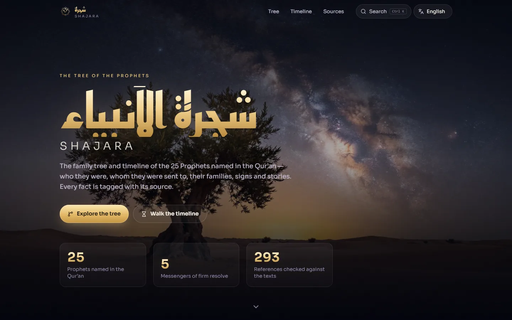

# Shajara · شجرة الأنبياء

> An interactive, source-cited family tree and timeline of the 25 Prophets named in the Qur'an — lineage, the peoples they were sent to, families, signs and stories — in Arabic, French and English.

**Live:** https://shajara-prophets.vercel.app · **Status:** v1.0.0 · **Idea:** #18 in the owner's ideas backlog · **Author:** Oussama EL HADJI



---

## What it does

- **Constellation tree** — the whole lineage from Adam to Muhammad ﷺ as a pannable, zoomable star map. Select a name to trace the line back to Adam. Sideways on wide screens (right-to-left in Arabic), top-down on phones. Family members (Shith, Azar, ‘Imran, Maryam) can be hidden.
- **Timeline** — the order of the prophets, anchored on Qur'anic statements ("‘Ad came after the people of Nuh", 7:69). Historians' date estimates are hidden until you ask for them.
- **Profiles** — for each prophet: whom he was sent to, his land, scripture, lifespan, marriage, children, signs and miracles, family links and the story, plus the main passages to read.
- **Live Qur'an** — every verse reference opens the Uthmani text, a translation (Saheeh International / Hamidullah / al-Tafsir al-Muyassar) and Mishary Alafasy's recitation, loaded from the Al Quran Cloud API. No verse is typed by hand.
- **Al-Mi‘raj** — the prophets met in each of the seven heavens (Sahih al-Bukhari 3207), and the five messengers of firm resolve.
- **Search** (Ctrl K or /) across names in three languages, Biblical names and story words; Arabic search ignores diacritics and hamza forms.
- Installable **PWA**, works offline for pages already visited; ar / fr / en with a full RTL layout.

## Accuracy is the product

Every fact and every relationship carries a **source level**:

| Level | Meaning |
|---|---|
| Qur'an | Stated in the Qur'an; the reference gives surah:verse |
| Hadith | From an authentic hadith (sunnah.com numbering) or the established sira |
| Tradition | From scholars, historians (Ibn Kathir, al-Tabari) or the Biblical account — not certain |
| Disputed | Scholars disagree, or the information is uncertain |

Rules: a level is never upgraded; Qur'an text is never typed by hand; dates before Muhammad ﷺ are labelled as estimates; **no images or depictions of the Prophets** — the scenes are generated landscapes of the places and events in their stories.

`npm run verify:sources` checks the dataset against the real texts: all 290+ Qur'an references must exist, about 200 of them must contain an expected word in the Saheeh International translation, and all 23 hadith references must exist and contain an expected word ([fawazahmed0/hadith-api](https://github.com/fawazahmed0/hadith-api)).

Found a mistake? [Open an accuracy issue](https://github.com/Bosaj/prophets-family-tree/issues/new?labels=accuracy) with a source.

## Stack

React 19 + TypeScript 7 + Vite 8, Tailwind CSS 4, d3-hierarchy (tree layout), custom SVG + canvas star field, vite-plugin-pwa, Vitest. Fonts: Reem Kufi (Arabic display), Amiri / Amiri Quran, Sora. Deployed on Vercel.

```
src/data/people.ts     the 25 prophets + family members (every fact sourced)
src/data/links.ts      relationships (parent, descendant, sibling, cousin, guardian…)
src/data/sources.ts    reference parsing, labels and links (quran.com, sunnah.com)
src/lib/layout.ts      tree layout, lineage, relatives
src/lib/quran.ts       live passage loader + recitation URLs
scripts/verify-sources.mjs   checks every reference against the texts
scripts/images.mjs     encodes scene images (WebP + AVIF, full 2048 px kept)
```

## Getting started

```bash
npm install
npm run dev            # http://localhost:5173
npm test               # data integrity, layout, search, router, UI smoke tests
npm run verify:sources # needs network
npm run build
```

## Roadmap

- v0.1 — sourced dataset of the 25 Prophets + relationship graph ✅
- v0.2 — interactive constellation tree + profiles ✅
- v0.3 — timeline view + miracles and stories ✅
- v0.4 — Arabic/French/English, search, PWA ✅
- Next — review of the dataset by a qualified scholar, share cards per prophet, a printable poster, a light "manuscript" theme, more family members (Hajar, Sarah, Asiya, Khadijah…) as nodes.

## For LLM agents & contributors

- **No images or depictions of Prophets, ever.** Use calligraphy, light, landscapes and geometry.
- Every fact needs a level and references. If you are not sure, use `tradition` or `disputed` — never upgrade.
- Add a keyword check for every new Qur'an or hadith reference in `scripts/verify-sources.mjs` and run it.
- Keep all three languages complete — `src/data/data.test.ts` fails on any missing translation.

## License

[MIT](LICENSE) — © 2026 Oussama EL HADJI. Qur'an text, translations and recitation are loaded from [Al Quran Cloud](https://alquran.cloud/api) and remain under their own terms.
