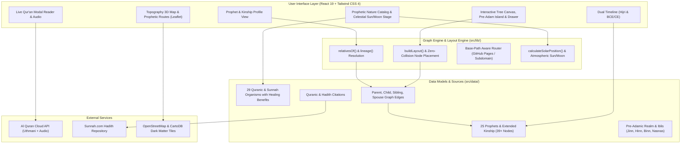

# Architecture & System Design

This document details the system design, components, and communication topology of **Shajara** (`@Bosaj/prophets-family-tree`).

---

## 🧩 Architectural Components

### 1. Interactive Family Tree Canvas (`src/components/Tree.tsx`)
- High-performance SVG-based genealogical tree renderer with custom drag/zoom viewport handling.
- **Dynamic Node Glowing & Kinship Aura:** Nodes are color-coded and animated based on their kind:
  - Gold celestial glow (`orb-gold`) for the 25 Prophets.
  - Rose aurora (`orb-spouse`) for holy wives and mothers of believers.
  - Emerald glow (`orb-child`) for children and direct descendants.
  - Amber glow (`orb-family`) for patriarchs, ancestors, and siblings.
- **Autonomous Pre-Adamic Realm Island:** Detached celestial realm floating above Adam representing earlier creations (Jinn, Iblis, Hinn, Binn, Nasnas) with a cosmic divide and smokeless fire aura, without any genealogical connection to Adam.
- **Collapsible Interactive Legend:** Floating pill toggle positioned safely above the bottom epoch ruler, offering bidirectional edge glowing for direct lineage, marriage, and lateral relationships.
- **Bottom Time-Space Epoch Ruler:** Centered, scrollable timeline bar mapping to the 8 historical epochs with precise multi-lingual dates and zero collision.

### 2. Genealogical Layout Algorithm (`src/lib/layout.ts`)
- Deterministic 2D coordinate placement algorithm ensuring:
  - Zero overlapping nodes across 16 filter permutations (Prophets, Spouses, Children, Extended family).
  - Wives positioned along vertical marriage generation lines.
  - Bidirectional RTL/LTR wide-screen orientation and vertical mobile layout.

### 3. Prophetic Nature & Celestial Theater (`src/components/NatureView.tsx`)
- Comprehensive dataset of 29 animals, plants, and foods cited in the Qur'an and Sunnah.
- Dual-layer framing ensuring full uncropped visual display on hover (blurred backdrop + object-contain foreground).
- Celestial atmospheric simulator tracking real solar altitude and lunar phases, rendered over sculpted desert dunes and drifting clouds.

### 4. Historical Topography & Prophetic Routes (`src/components/TopographyMap.tsx`)
- Leaflet-based interactive mapping of historical prophetic routes with station waypoints, archaeological references, and elevation visualization.

### 5. Client Routing & GitHub Pages Support (`src/lib/router.ts`)
- Lightweight sync external store router equipped with `withBase()` and `stripBase()` to support seamless subpath deployments (`https://bosaj.github.io/prophets-family-tree/`) and root domains alike, backed by automated `404.html` SPA routing.
