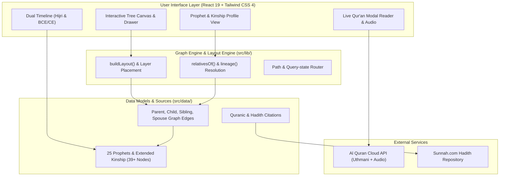

# Architecture & System Design

This document details the system design, components, and communication topology of **Shajara** (`@Bosaj/prophets-family-tree`).

---

## 🧩 Architectural Components

### 1. Interactive Family Tree Canvas (`src/components/Tree.tsx`)
- High-performance SVG-based genealogical tree renderer with custom drag/zoom viewport handling.
- **Dynamic Node Glowing & Kinship Aura:** Nodes are color-coded and animated based on their kind:
  - Gold celestial glow (`orb-gold`) for the 25 Prophets.
  - Rose aurora (`orb-spouse`) for holy wives and mothers of believers.
  - Emerald glow (`orb-child`) for children and direct descendants.
  - Amber glow (`orb-family`) for patriarchs, ancestors, and siblings.
- **Interactive Lineage Tracer:** Clicking any figure calculates their unbroken ancestral chain back to Adam using `lineage(id)` and lights up an animated energy pulse (`lineage-flow`) along the genealogical path.
- **Filtering Toolbar:** Immediate client-side re-layout with toggles for:
  - Prophets only
  - Include Holy Wives & Spouses
  - Include Children (sons & daughters)
  - Include Extended Family (parents, ancestors, siblings)

### 2. Genealogical Layout Algorithm (`src/lib/layout.ts`)
- Deterministic 2D coordinate placement algorithm ensuring:
  - Strict hierarchical vertical ordering by generational depth.
  - Sibling left-to-right sorting based on `CHILD_ORDER` to prevent edge crossings and overlapping branches.
  - Bezier curve edge calculation linking parents to offspring and spouses to households.

### 3. Dual Timeline Engine (`src/components/Timeline.tsx`)
- Synchronized dual-calendar view displaying events in both Hijri (BH/AH) and BCE/CE formats.
- Filterable by 7 distinct historical eras.
- Expandable event cards linking milestones directly to Qur'anic verses and Hadith citations.

### 4. Profiles & Life Events (`src/components/Person.tsx`)
- Detailed profile view showcasing:
  - Sacred titles and Arabic calligraphy (Reem Kufi & Amiri fonts).
  - Dates and lifespan (Hijri and Gregorian).
  - Parents (Father, Mother, Foster Mother).
  - Wives & Spouses.
  - Children (sons and daughters).
  - Siblings (brothers and sisters).
  - Major life events & milestones with authentic source levels.
  - Qur'anic verses with one-click live reader.

### 5. Live Qur'an Modal Reader (`src/components/QuranModal.tsx`)
- Fetches Uthmani text from the Al Quran Cloud API live to prevent typographical transcription errors.
- Plays Mishary Rashid Alafasy recitations with audio controls.
