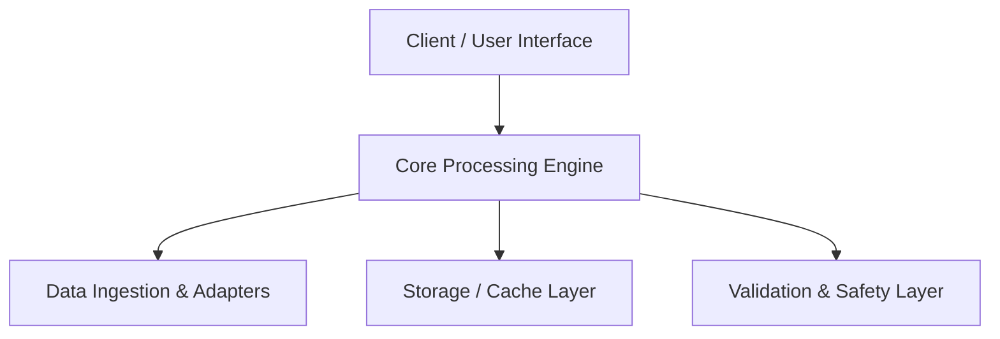

# Architecture & System Design

This document details the system design, components, and communication topology of **Interactive Prophets Family Tree & Quranic Lineage**.

## Core Subsystems

### 1. Ingestion & Preprocessing
Handles raw input data, validates schema compliance, normalizes inputs, and eliminates malformed requests.

### 2. Processing & Business Logic
Executes the primary business logic and domain processing pipelines efficiently and deterministically.

### 3. Verification & Safety Guards
Enforces safety rules, sanitizes data structures, and validates output integrity before presentation.

### 4. Storage & State Management
Maintains persistent state, caches hot queries, and guarantees data durability.
